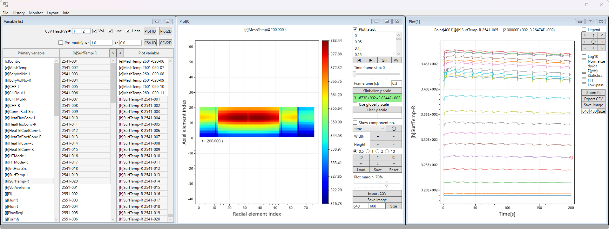

  

# DAVIS

**D**ata **A**nalytics **V**isual **I**nterface for **S**ystem codes: a Windows desktop post-processor for **RELAP5/MOD3.x** printed output files (`.o`) and CSV data.

RELAP5 writes its results as large fixed-width text listings. DAVIS reads such a listing once, organizes every time step by component and variable, and lets you plot, compare, animate and export the results without writing scripts.

📖 **[User guide](userguide.md)**: how to use every window and control.

## Features

- **Open by menu, `Ctrl+O`, or drag and drop** onto the Variable list window.
- **Variables by type:** volumes `[v]`, junctions `[j]`, heat structures `[h]`, mesh temperatures `[e]`, pumps `[p]`, reactor power `[q]`, trips `[t]`, gap conductance `[g]`, control variables `[c]`, and CSV columns.
- **Mix variables freely** in one plot list, e.g. `[v]Pressure 101-010000` next to `[j]MassFlow 105-000000`.
- **1D plots** with log10, normalize, dy/dt, ∫y dt, statistics, FFT and low-pass views, plus a readout of the data point nearest the cursor.
- **2D heatmaps** of hydraulic components and of heat structure mesh temperatures. Components can be moved, resized and rotated, and the layout saved to a `.2dcfg` file.
- **Animation export** of 2D plots to GIF or AVI (M-JPEG).
- **CSV export** of 1D series and 2D tables. Exported files reopen in DAVIS with their original variable names.
- **Monitor mode** re-reads a running calculation every 10 s to 10 min and redraws all open plots.
- **Plot history and replay**, plus a command window for scripted opens and exports (`OPEN:`, `CSV1D:`, `CSV2D:`).

## Performance

The parser reads the file once into a compact byte buffer and decodes lines only as needed. On a 526 MB RELAP5 output (4,001 major edits), loading takes about 15 s, peak memory is about 1 GB, and the app holds about 0.4 GB once the file is loaded. Number parsing is independent of the PC's regional settings.

## Limitations

The RELAP5 output parsing logic was developed by trial and error, by analyzing example outputs created by the author. Therefore, there may be edge cases that cause the parser to fail.

## Requirements

- Windows with .NET Framework 4.8.1 (built into recent Windows 11; a free download for Windows 10)
- No installation: DAVIS is a single `DAVIS.exe` with all libraries built in
- Output from RELAP5/MOD3.3 (ASCII, one system). Other RELAP5/MOD3.x variants may work but are less tested. For multi-case outputs, only the last case is loaded.

## Built with

[ScottPlot](https://github.com/ScottPlot/ScottPlot) ·
[WPF MDI](https://github.com/flamegreat/wpfmdi) ·
[FftSharp](https://github.com/swharden/FftSharp) ·
[SharpAvi](https://github.com/baSSiLL/SharpAvi) ·
[Fody](https://github.com/Fody/Home) / [Costura](https://github.com/Fody/Costura)
(all MIT licensed; see *Info → Acknowledgement* in the app).

## Author

© 2023–2026 Hyung Min Son. All rights reserved. The software is provided as-is, without any warranty.
