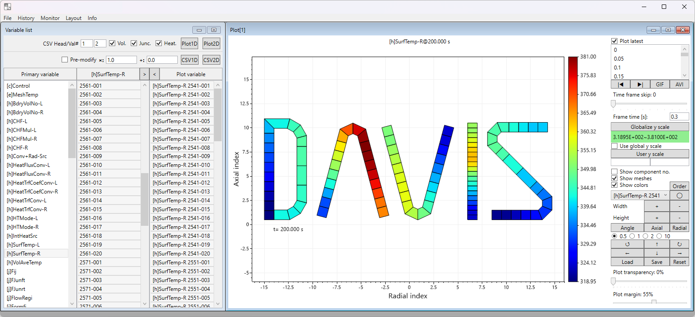

# DAVIS User Guide

<p align="center">
  
</p>

DAVIS (**D**ata **A**nalytics **V**isual **I**nterface for **S**ystem codes) reads **RELAP5/MOD3.x** printed output files and CSV data, and lets you plot, animate and export the results. This guide describes every window and control. The same text is available in the program under **Info → User guide**.

## Contents

- [Getting started](#getting-started)
- [Variable names](#variable-names)
- [1. Menu items](#1-menu-items)
- [2. Variable list window](#2-variable-list-window)
- [3. Debug window](#3-debug-window)
- [4. Plot1D window](#4-plot1d-window)
- [5. Plot2D window](#5-plot2d-window)

## Getting started

1. Run `DAVIS.exe` (Windows with .NET Framework 4.8.1; no installation needed).
2. Open a RELAP5 output file with **File → Open**, **Ctrl+O**, or by dropping it on the **Variable list** window.
3. In the **Variable list** window, select a **Primary variable** (e.g. `[v]Pressure`), then one or more components in the **Secondary variable** list, and press **>** to copy them to the **Plot variable** list.
4. Select items in the **Plot variable** list and press **Plot1D** (time history), **Plot2D** (heatmap), **CSV1D** or **CSV2D** (export).

## Variable names

Primary variable names start with a type prefix:

| Prefix | Type | Example |
|---|---|---|
| `[v]` | Volume | `[v]Pressure` |
| `[j]` | Junction | `[j]MassFlow` |
| `[h]` | Heat structure (boundary) | `[h]SurfTemp-L` |
| `[e]` | Heat structure mesh temperature | `[e]MeshTemp` |
| `[p]` | Pump | `[p]RPM` |
| `[q]` | Reactor power | `[q]Power` |
| `[t]` | Trip | `[t]Trip` |
| `[g]` | Gap conductance | `[g]Conductance` |
| `[c]` | Control variable | `[c]Control` |
| `[C]` | CSV column | `[C]SV` |

Plot variables are written as `{Primary variable} {Secondary variable}`, e.g. `[j]MassFlow 101-010000`.

---

## 1. Menu items

### File

- **File → Open**: Open and read RELAP5 output or CSV (Comma Separated Values) data.
  - Shortcut: **Ctrl+O** while the main window has the focus.
  - A file can also be opened by dragging it from Explorer and dropping it on the Variable list window.
  - Tested with most RELAP5/MOD3.3iy output data (ASCII) with 1 system.
  - For output data with multiple cases, only the last case is read.
  - Opening a file closes all plot windows and clears the plot history and the Debug window log.
  - Not available while a file is still being read (a message is shown).
- **File → Close**: Close opened data and plots. The plot history and the Debug window log are also cleared. Use it to release memory if DAVIS uses too much. Not available while a file is still being read.

#### CSV data

- The file extension must be `.csv`.
- The 1st row is a header row, and the 1st column is a time column.
- The line numbers of the header and of the first data row can be set in the two boxes next to **CSV Head/Val#** in the Variable list window.
- A header with a space (e.g. `[v]Pressure 255-010000`) is split at the 1st space: the text before it (`[v]Pressure`) becomes a Primary variable and the rest (`255-010000`) its Secondary variable, as for RELAP5 output.
- Headers without a space (e.g. `256-010000`) are listed under the Primary variable `[C]SV`.
- CSV files saved by the **CSV1D** button can therefore be opened with their original variable names.

### History

- **History → Re-read**: Open and read the output data opened before.
- **History → Re-plot**: Re-plot previously created plots. To keep window positions, avoid closing plot windows.
- **History → Clear**: Clear the history of previously created plots.

### Monitor

Monitoring repeats Re-read and Re-plot at a fixed interval, to follow a running calculation.

- **Monitor → 10, 30, 60 sec / 2, 5, 10 min**: Sets the monitoring interval.
  - Reading takes longer as the calculation progresses; choose a longer interval if monitoring is not responsive enough.
  - A new interval takes effect at the next **Start**. To change it during monitoring, select **Stop**, then **Start** again.
- **Monitor → Start**: Starts monitoring. The first re-read starts about 1 second after Start.
- **Monitor → Stop**: Stops monitoring.

### Layout

- **Layout → Cascade**: Arranges windows in a cascading manner.
- **Layout → Tile**: Arranges windows in a tiled manner.

### Info

- **Info → User guide**: Displays this user guide.
- **Info → About**: Displays program information with developer logs.
- **Info → Acknowledgement**: Displays acknowledgements and licenses of the libraries used.

> **Memory:** while reading, DAVIS needs memory of about twice the size of the output file (about 1 GB for a 526 MB output) and less once the file is loaded, plus memory for open plots.

---

## 2. Variable list window

### Lists

- **Primary variable** list: Available variables (e.g. `[v]Pressure`, `[j]MassFlow`).
- **Secondary variable** list: Components (volumes, junctions, heat structures, etc.) that have the variable selected in the Primary variable list.
- **>** button (right of "Secondary variable"): Copies the selected Secondary variables to the Plot variable list as `{Primary variable} {Secondary variable}` (e.g. `[j]JunArea 5-010000`). Items already in the list are not added again.
- **Plot variable** list: Collects the variables used by the Plot1D, Plot2D, CSV1D and CSV2D buttons. Variables of different Primary variables can be mixed (e.g. `[v]Pressure` and `[j]MassFlow`). Select several items with **Ctrl** or **Shift** + click.
- **<** button (left of "Plot variable"): Removes the selected items from the Plot variable list.
- Items not in the currently opened file (Primary variable or component missing) are skipped when plotting and exporting; when none of the selected items is in the file, a message is shown.

### Drag and drop

Dropping an output or CSV file anywhere on this window opens it, the same as **File → Open**. When several files are dropped, only the first is opened. A drop is ignored while a file is still being read.

### Read options

- **Vol.** checkbox: When unchecked, volume component data (including pump data) are not read.
- **Junc.** checkbox: When unchecked, junction component data are not read.
- **Heat.** checkbox: When unchecked, heat structure component data are not read.

Changes take effect at the next Open or Re-read.

### Plot and export

- **Plot1D** button: Plots the selected Plot variable list items against time. The legend shows each item name as in the Plot variable list. The vertical axis title is the Primary variable name when all items share it (e.g. `[j]FWalfj`), otherwise "Value".
- **Plot2D** button: Displays the selected items as a heatmap.
  - Items may belong to several Primary variables of volume (`[v]`), junction (`[j]`), heat structure (`[h]`) and mesh (`[e]`) type; they share one color scale. Otherwise a message is shown and nothing is plotted.
  - Mesh items of several heat structures can be selected; each heat structure is plotted as its own z-r heatmap.
  - CSV data can be plotted when its Primary variable is of these types (e.g. `[h]CHF-R` read from a CSV header); `[C]SV` items cannot.
- **Pre-modify** checkbox: When checked, all plot and export data are modified as `A × value + B`, where A and B are the values in the **×** and **+** boxes next to the checkbox.
- **CSV1D** button: Saves the selected items to a CSV file. Column headers are the item names as in the Plot variable list (e.g. `[j]MassFlow 101-010000`). The same as **Export CSV** on the Plot1D window, without the plot window's views (statistics, dy/dt, etc.).
- **CSV2D** button: Saves the selected items at the last time step to a CSV file.
  - Items may belong to several Primary variables, all of `[v]`, `[j]`, `[h]` or `[e]` type.
  - Each Primary variable is written as its own table, in the same format as **Export CSV** on the Plot2D window with the last time step selected. Tables are sorted by Primary variable name and stacked vertically, separated by a blank line.
  - Mesh (`[e]`) items are written as one z-r table per heat structure, in heat structure number order, titled e.g. `[e]MeshTemp 200@0.500 s`.
  - For `[v]`, `[j]` and `[h]` tables (here and in **Export CSV** on the Plot2D window), the header row lists `(comp. no.)` followed by the sub-volume numbers as in the Plot variable list. For example, `[h]HeatTrfConv-R 2541-001` and `[h]HeatTrfConv-R 2541-002` give the header `(comp. no.),001,002`. A column that no selected item fills is headed by its column number.

CSV files use `.` as the decimal point, whatever the PC's regional settings.

---

## 3. Debug window

The Debug window logs file opens and CSV exports, and runs them again as commands.

### Log list (upper black region)

- Shows the file open and CSV export history: entries are added when a file is opened (including by `OPEN` commands) and when the **CSV1D** or **CSV2D** button saves a file.
- The log is cleared when a new file is opened or closed.
- Selected entries (several with **Ctrl** / **Shift**) are copied to the command window below.

### Command window (lower light-yellow region)

Type commands, or select them from the log. Enter one command per line; the lines run in order and blank lines are skipped. Command names are not case-sensitive (`open:` works as `OPEN:`).

**Grammar 1 – file open**

```
OPEN:{file name with absolute path}
```
```
OPEN:D:\output.dat
```

**Grammar 2 – 1D CSV export**

```
CSV1D:({plot variable names separated by commas}),{multiplication},{addition},{save file name with absolute path}
```
```
CSV1D:([j]MassFlow 101-010000,[v]Pressure 101-010000),1,0,D:\out.csv
```

Plot variable names are written as in the Plot variable list; different Primary variables can be mixed. This is the form logged by the CSV1D button. The older form is still accepted:

```
CSV1D:{Primary variable},({Secondary variables separated by commas}),{multiplication},{addition},{file}
```
```
CSV1D:[j]MassFlow,(101-010000,101-020000),1,0,D:\j_MassFlow.csv
```

**Grammar 3 – 2D CSV export**

```
CSV2D:({plot variable names separated by commas}),{multiplication},{addition},{save file name with absolute path}
```
```
CSV2D:([j]MassFlow 101-010000,[v]Pressure 101-010000),1,0,D:\out2D.csv
```

This is the form logged by the CSV2D button. The older form is still accepted:

```
CSV2D:{Primary variable},({Secondary variables separated by commas}),{multiplication},{addition},{file}
```
```
CSV2D:[j]MassFlow,(101-010000,101-020000),1,0,D:\j_MassFlow2D.csv
```

**Rules**

- In the older forms, item names are the Secondary variable part of the names (volume, junction, heat structure numbers, etc.).
- The save file name is required and must not contain a comma.
- The multiplication and addition values are the Pre-modify values; they use `.` as the decimal point (e.g. `1.5`) regardless of the PC's regional settings.
- Variable names not in the loaded file are reported and the command is not executed.

### Run and Exe

- **Run** checkbox: When unchecked, execution stops before the next command. Check it again before pressing Exe.
- **Exe** button: Runs the commands in the command window. Existing files are **overwritten without asking**.
  - Progress is shown left of the Run checkbox: `On[2/3]` while the 2nd of 3 commands runs, `Done[2/3]` after it, and `Complete[3/3]` when all are finished.
  - When a command fails (e.g. the file cannot be read or written), execution stops and `Failed[2/3]` is shown in red.
  - The Exe button is disabled while commands are running.

---

## 4. Plot1D window

- **Uppermost label**: Value of the data point nearest to the mouse cursor. For lines of 10,000 points or more it is the point nearest in x (time).
- **Large data**: Lines of 10,000 points or more are drawn from the lowest and highest value in each pixel column, which looks the same as drawing every point. A plot of several lines of 1,000,000 points each opens in under a second and pans and zooms smoothly. A line whose x goes back (e.g. two runs joined) or that holds NaN or infinite values is drawn point by point as before, which gets slow at about 100,000 points.
- **Legend** checkbox: Shows or hides the legend.
- **Legend position** arrows: Set the position of the legend.

### Views

Only one of the following can be used at a time; checking one unchecks the others.

- **Log10**: Plots log10 of the values (not a logarithmic axis). Positive value → log10(value), 0 → 0, negative value → −log10(|value|).
- **Normalize**: Plots values scaled to 0~1: (value − min) / (max − min). Constant data are shown as 0.5.
- **dy/dt**: Plots the time derivative, dY/dt at (t + Δt/2) = {value(t + Δt) − value(t)} / Δt. One point fewer than the data.
- **Σ(yΔt)**: Plots the time integral from 0, Σ(yΔt)(t) = Σ(yΔt)(t − Δt) + 0.5 × {value(t) + value(t − Δt)} × Δt. One point fewer than the data (the 1st point is omitted).
- **Statistics**: Plots, at each time:
  - `y_bar`: mean of the selected items;
  - `minimum` / `maximum`: smallest / largest value among them;
  - `y_bar-2s` / `y_bar+2s`: mean ∓ 2 × sample standard deviation.

  Statistics need at least 2 selected items.
- **FFT**: Plots frequency against spectral power density. The x-axis is log10 of frequency. Data with non-uniform time steps are interpolated onto a uniform grid built from the greatest common divisor of the time steps; for performance the time step resolution is limited to 0.005 s. Frequencies with no power (e.g. a constant variable) are left as gaps.
- **Low-pass**: Plots low-pass filtered data. The cut-off frequency is fixed to 1 / (10 × minimum time step). Abrupt changes in the data may over- or undershoot.

### Buttons

- **Zoom fit**: Resets the zoom to show the entire plot.
- **Export CSV**: Saves the current plot to a CSV file. Column headers are the legend names; in the FFT view the first column holds the frequency.
- **Save image**: Saves the current plot as PNG, JPG or BMP, at the current plot window size.
- **Size**: Sets the size of the plot window in pixels, from the width and height boxes left of the button.

---

## 5. Plot2D window

Displays the selected heat structure or hydraulic components as heatmaps.

- Heat structure mesh (`[e]`): each heat structure is one z-r heatmap (axial 1 at the bottom), listed in the component list as e.g. `[e]MeshTemp 2541` and moved, resized and rotated like other components.
- Hydraulic components (`[j]`, `[v]`) and heat structure components (`[h]`): each component occupies one column, with its sub-volumes plotted from top to bottom.
- Components are placed side by side, ordered by Primary variable name, then by component number; a mesh heatmap takes as many columns as it has radial points.
- 2D plots are not updated by monitoring (for performance), but are rebuilt by Re-plot. Use 2D plots with monitoring stopped (**Monitor → Stop**). To keep positions during Re-plot, avoid closing plot windows.
- **Uppermost label**: Primary variable name (or "Value" when several are plotted) and the time shown.

### Time

- **Plot latest** checkbox: Shows the latest time step.
- **Time list**: All time steps. Uncheck **Plot latest** and double-click an item to show that time step. Selecting a time also resets the zoom.
- **\|◀** button: Previous time step. Press and hold to step back continuously.
- **▶\|** button: Next time step. Press and hold to step forward continuously.

### Animation export

- **GIF** button: Exports all time steps as one animated GIF.
  - It can take a while. Progress is shown in the uppermost label (e.g. `[GIF frame 12/300]`) while the window stays responsive.
  - During export the button reads **Stop**; press it to stop without saving a file.
  - All frames are held in memory until the GIF is written, so long exports need much memory.
  - Each time step is shown for the time in the **Frame time** box.
  - The image size follows the plot window size. "GIF export complete!" is shown when done.
- **AVI** button: Exports all time steps as one AVI movie (M-JPEG).
  - Progress is shown in the uppermost label while the window stays responsive.
  - During export the button reads **Stop**; press it to stop and remove the partial file.
  - Each time step is shown for the time in the **Frame time** box (frame rate = 1 / frame time).
  - The movie size follows the plot window size. "AVI export complete!" is shown when done.
- **Time frame skip** slider (0~10): N time steps are left out between exported frames (e.g. 2 exports steps 1, 4, 7, …); the first and last time steps are always exported.
- **Frame time** box: Display time of each time step in GIF and AVI export, in seconds (0.01~100, default 0.3). GIF stores it in 1/100 s steps; some viewers show very short times (below about 0.02 s) slower.

### Color scale

- **Globalize y scale** button: Scans all time steps and shows the overall minimum and maximum in the green label below. If **Use global y scale** is checked, the plot uses the new range at once.
- **Use global y scale** checkbox: Uses the global range for the color scale.
- **User y scale** button: Uses the range typed in the boxes below (left: minimum, right: maximum; minimum must be smaller than maximum). Colorbar labels follow the number format typed as maximum (e.g. `5.123` shows `0.000`~`5.123`; `5.123E+05` shows labels like `2.562E+05`).

Without these, the color scale spans the values of the time step shown.

### Component positions

- **Show component no.** checkbox: Labels each component in 2 lines: Primary variable name (e.g. `[h]HeatTrfConv-R`), then component number (e.g. `2541`).
- **Show meshes** checkbox: Outlines every sub-volume and mesh cell. Off by default.
- **Show colors** checkbox: On by default. Unchecked, all cells are drawn white with only their outlines and no colorbar; **Show meshes** is then checked and stays checked until colors are shown again.
- **Order** button: Opens *Draw order (upper one first)*, listing the components (Index from 1, Name) in the order they are drawn; later ones cover earlier ones where they overlap. Select one or more rows (Ctrl/Shift+click) and use **Up**/**Down** to move them one row, **Top**/**Bottom** to move them to either end, or **Sort** to go back to the component list order. The plot is redrawn after each button. Components keep their positions; only which one is drawn on top changes.
- **Component** dropdown: Selects the component to adjust, listed as `{Primary variable} {component number}` (e.g. `[h]HeatTrfConv-R 2541`) in the same order as in the plot. The last item, `time`, positions the time label.
- **⚪** button: Resets the selected component.
- **Width +/−**: Changes the selected component's width by 10% of its original width (10%~1000%).
- **Height +/−**: Changes the selected component's height by 10% of its original height (10%~1000%).
- **Angle** button: Opens *Sub-volume angles* for the selected 1-D component (not for mesh items). The scrollable list has one row per sub-volume: its index (from 1) and an editable angle in degrees. Each angle turns that sub-volume relative to the preceding one (+ clockwise), so angles 0, 30, 0, 0 bend the column from sub-volume 2 on and 0, 30, −30, −30 zigzag it. **Save** applies the edited angles and redraws; **Load** shows the angles in use again. Sub-volume 1 is drawn at the bottom of each column.
- **Axial** button: Opens *Sub-volume axial lengths*, with the same list and **Save**/**Load** buttons, for 1-D components and mesh items. Each length (above 0, default 1) multiplies the height of one sub-volume, or of a whole mesh axial row, so `1, 2, 1, 0.5` doubles sub-volume 2 and halves sub-volume 4. The bottom stays in place, and lengths combine with angles.
- **Radial** button: Opens *Sub-volume radial widths*, with the same list and buttons. Each width (above 0, default 1) multiplies the width of one 1-D sub-volume, centered on the column's center line, or of one mesh radial column (the list then has one row per radial element, and the left edge stays in place). Widths combine with angles and lengths.
- **0.5 / 1 / 2 / 10** radio buttons: Step size of the arrow buttons.
- **↑ ← ↓ →**: Move the selected component one step.
- **⭯** / **⭮**: Rotate the selected component 5° counterclockwise / clockwise (limited to −180°~180°).
- **Load** button: Loads component positions from a configuration file (`*.2dcfg`). In files saved before component names included the Primary variable, a component number applies to that component of every Primary variable shown.
- **Save** button: Saves the component positions to a configuration file (`*.2dcfg`), one line per component in draw order; **Load** takes that line order as the draw order. 1-D components also keep their sub-volume angles after `;ang:`, axial lengths after `;len:` and radial widths after `;wid:`, e.g. `[h]CHF-R 2541,-11.5,0.5,0,1,1;ang:0,30,0,0;len:1,2,1,0.5;wid:1,2,1,0.5`; mesh items get `;len:` and `;wid:` only. Files without them load with angles 0 and lengths and widths 1.
- **Reset** button: Resets all component positions.
- **Plot transparency** slider: Makes the component colors and the background of the time stamp transparent, from 0% (opaque, default) to 99%; meshes and component labels stay as they are.
- **Plot margin** slider: Adjusts the plot margins (1~99%, the same on all sides).

### Other buttons

- **Export CSV**: Saves the time step shown to a CSV file (tables as described for **CSV2D** above).
- **Save image**: Saves the current plot as PNG, JPG or BMP, at the current plot window size.
- **Size**: Sets the size of the plot window in pixels, from the width and height boxes left of the button.
